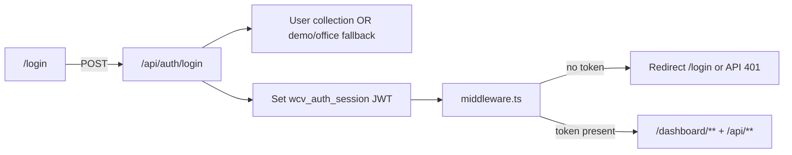
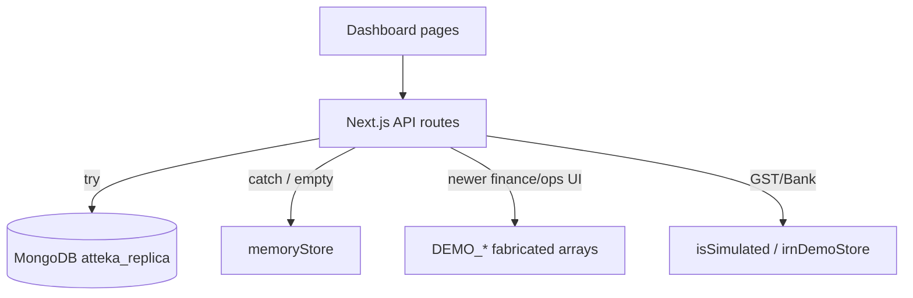
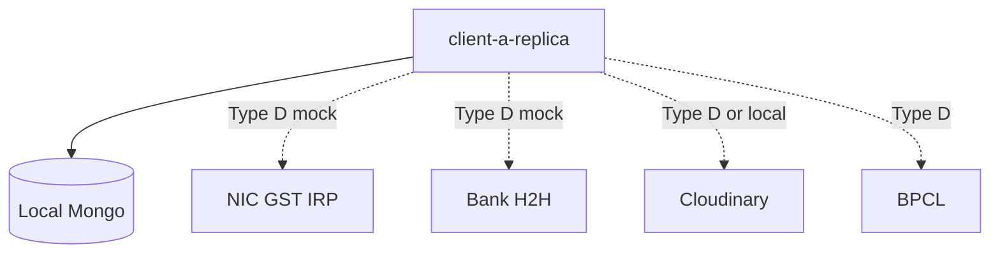
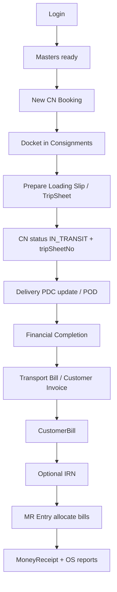
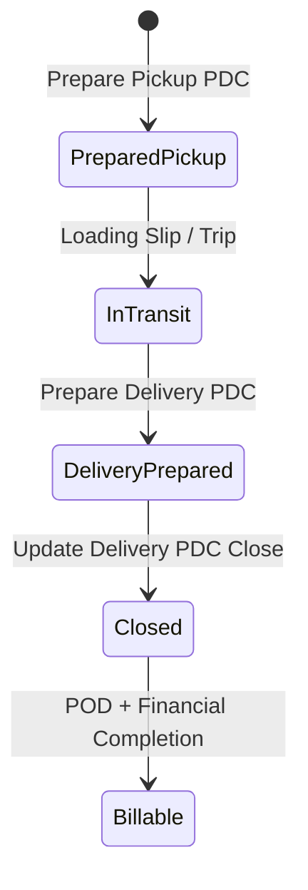
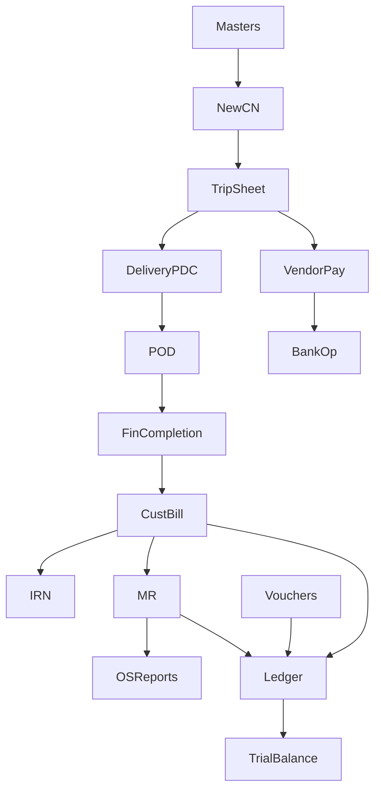

# PROJECT_FUNCTIONAL_GAP_ANALYSIS.md

> **Master blueprint for completing `client-a-replica` as an independent Atteka Logistics ERP clone.**  
> **Phase:** Analysis & documentation only (no code, config, or database changes were made for this document beyond creating this file).  
> **Generated:** 10 Nov 2026  
> **Scope:** `c:\Software\Atteka\client-a-replica`  
> **Method:** Static inventory of App Router pages, API routes, Mongoose models, middleware, module catalog, hub hrefs; prior Mongo connectivity check on `atteka_replica` (20 collections).  
> **Constraint:** No interaction with the original client production website or private production APIs.

---

## 1. Project Overview

`client-a-replica` is a Next.js App Router application that visually and structurally replicates a WebCoreVision-style logistics TMS/ERP (Atteka). It already includes:

- Login + cookie JWT session gate
- Large dashboard surface (~158 pages across Operations, Finance, Fleet, CRM, Tracking, Reports, Masters, Admin, Exceptional)
- ~106 API route handlers
- 25 Mongoose models
- Dual data strategy: **MongoDB** for core ops/masters + many report queries; **in-process memoryStore** fallback; **fabricated DEMO arrays** for many newer finance/bank/operations UI screens
- Simulated GST IRN and bank payment markers (`isSimulated`)

**Business goal of this blueprint:** make the clone fully usable *without* depending on the original client backend, by completing frontend workflows, local APIs, and a local/dev database—using mocks only where external networks (NIC GST, bank H2H, Cloudinary) are unavailable.

| Layer | Count | Notes |
|------|------:|-------|
| Dashboard pages | ~158 | Finance heaviest (~63) |
| API routes | ~106 | Hybrid classifications |
| Module catalog entries | ~147 | Searchable navigation |
| Mongo-touching APIs | ~50–55 | Often + memoryStore fallback |
| Explicit DEMO/Fabricated APIs | ~45–50 | Especially `/api/finance/*`, `/api/bank/*` (except payment) |
| Mongoose models | 25 | See §14 |

---
## 2. Existing Project Architecture

### 2.1 Stack
- **Next.js** ^14.2.18 (App Router), **React** 18.3, **TypeScript** 5.6, **Tailwind** 3.4
- **mongoose** ^8.7 → MongoDB
- **Auth:** `jsonwebtoken` + `bcryptjs`, cookie `wcv_auth_session`
- **Validation:** `zod`
- **UI:** `lucide-react`, shared WCV cards/ribbons, `jsbarcode`

### 2.2 App structure
```
src/app/(auth)/login/
src/app/(dashboard)/dashboard/**   # ERP pages
src/app/api/**                     # route handlers
src/models/                        # mongoose schemas
src/lib/                           # mongodb, auth, memoryStore, moduleCatalog, breadcrumbs, booksEngine
src/components/                    # admin/crm/common
src/services/                      # gstService, storageService, bankService
scripts/seed.js
src/middleware.ts
```

### 2.3 Auth architecture


**Findings:** Middleware checks **cookie presence only** (does not re-verify JWT signature on every request — inferred from `middleware.ts`). Login supports Mongo users, office env credentials, and demo userIds (`AL002`, `ADMIN01`, `DEMO01`) with password fallbacks.

### 2.4 Data architecture


### 2.5 Environment variable NAMES only
`MONGODB_URI`, `AUTH_SECRET`, `PORT`, `NEXT_PUBLIC_APP_URL`, `CLOUDINARY_*`, `GST_IRP_MODE`, `GST_NIC_*`, `ATEKA_OFFICE_USER`, `ATEKA_OFFICE_PASSWORD`, `ATEKA_AUTH_SECRET`

### 2.6 Third-party adapters
| Integration | Surface | Reconstructability |
|-------------|---------|-------------------|
| Cloudinary | upload API | Type D local store or sandbox |
| NIC GST IRP | gstService, `/api/gst/irn` | Type D when off; Type E live |
| Bank H2H/statements | `/api/bank/*` | Type D sim; Type E real bank |
| BPCL fuel | fleet BPCL APIs | Type D manual |

---

## 3. Complete Page and Module Inventory

### 3.1 Section page counts
| Section | Pages |
|---------|------:|
| finance | ~63 |
| reports | ~40 |
| operations | ~16 |
| fleet | ~9 |
| masters | ~7 |
| admin | ~6 |
| tracking | ~6 |
| crm | ~4 |
| exceptional | ~4 |
| other | ~3 |

### 3.2 Operations
| Module | Route | Status |
|--------|-------|--------|
| Operations hub | `/dashboard/operations` | Hub |
| Freight Booking | `/dashboard/operations/freight-booking` | UI hub |
| CN Operations | `/dashboard/operations/cn-operations` | Partially |
| Edit Pending CNs | `.../edit-cns` | Partially (Mongo+demo) |
| View/Print CN | `.../view-print-cn` | Partially |
| New CN | `/dashboard/operations/new-cn` | Mongo-backed |
| Dockets | `/dashboard/operations/dockets` | Mongo-backed |
| Docket print | `.../dockets/[id]/print` | Partially |
| TripSheets hub | `/dashboard/operations/tripsheets` | Partially |
| Prepare Pickup PDC | `.../prepare-pickup-pdc` | Demo POST |
| Prepare Delivery PDC | `.../prepare-delivery-pdc` | Demo POST |
| Update Delivery PDC | `.../update-delivery-pdc` | Demo |
| Prepare Loading Slip | `.../prepare` | Mongo list / demo |
| Add Loading Sheet | `.../prepare/new` | Mongo POST |
| View Print Document | `/dashboard/operations/view-print` | Not fully verified |
| Live Tracking | `/dashboard/operations/tracking` | Links |

### 3.3 Finance hubs
| Module | Route | Status |
|--------|-------|--------|
| Customer Billing children | `/dashboard/finance/customer-billing/*` | Mixed persist |
| Transport Bill / View Print Bills | transport-bill, view-print-bills | Stronger Mongo billing |
| Other Bill / Invoice / POD / Completion | child routes | Demo APIs |
| Vendor Billing suite | `/dashboard/finance/vendor-billing/*` | Demo APIs |
| MR Entry suite | `/dashboard/finance/mr-entry/*` | Mixed; `/api/mr` Mongo |
| Vouchers suite | `/dashboard/finance/vouchers/*` | Mostly demo |
| Cheque Management | `/dashboard/finance/cheque-management/*` | Partial/demo |
| CBS / Bank Payment / Statement | cash-bank-statement, bank-* | Demo bank APIs |
| E-Invoice IRN | `/dashboard/finance/e-invoice/*` | Simulated unless NIC live |
| Print Dot-Matrix | `/dashboard/finance/print-dot-matrix/*` | Demo helpers |
| Legacy Billing | `/dashboard/finance/billing` | Real UI + **placeholder sink** |

### 3.4 Reports
| Hub | Status |
|-----|--------|
| Operations reports | Mongo query pages exist |
| Finance reports | Mongo query pages exist |
| Accounts ledgers | Demo fabricated |
| Final accounts | Demo / partial overlay |
| Purchase / ERP Tracking / Company Vehicles | **Placeholder sinks** |

### 3.5 Masters / Admin / Fleet / CRM / Tracking / Exceptional
- **Masters CRUD:** generally Fully Functional (Mongo).
- **Fleet trip-management:** Mongo-backed.
- **CRM visits/quotations:** Mongo + memory; leads/activity demo.
- **Tracking CN:** Mongo; party/PAN demo; some cards are sinks.
- **Exceptional:** largely UI/placeholder.
- **Admin:** mostly Mongo; Route Cost Master UI-only; PAN verify demo.

---

## 4. Existing Functionalities

**Confirmed working locally:**
1. Login session cookie + middleware gate.
2. Global module search catalog + breadcrumbs for most wired routes.
3. Masters: customers, vendors, vehicles, branches, customer GST, docket numbers (auto-seed pool).
4. New CN booking → consignments Mongo (+ docket allocation).
5. Dockets list/edit/POD upload path.
6. Prepare Trip Sheet (`prepare/new`) → `POST /api/tripsheets` Mongo + CN trip linking.
7. Customer billing via `/api/billing` (CustomerBill).
8. Money receipts via `/api/mr` (collection may be empty).
9. Many Operations/Finance **report query** pages (empty if no data).
10. Fleet advance/settlement/voucher payment APIs.
11. CN tracking APIs.
12. Admin company structure / business partners / SAC codes.
13. UI workflows for newer finance/ops screens with fabricated data (filters/tables/toasts).

---

## 5. Missing Functionalities

### Theme A — Persistence gap
Most `/api/finance/*` and several `/api/operations/*` PDC endpoints return success **without durable domain writes**.

### Theme B — Placeholder navigation
Report/Exceptional/Tracking cards open unrelated modules (`/finance/billing`, `e-invoice`, `vendor-billing`, `masters/vehicles`).

### Theme C — Ledger incompleteness
`LedgerEntry` exists; accounts/final-accounts UIs largely fabricate COA. Double-entry from bills/MR/vouchers/bank is incomplete.

### Theme D — External networks
Live NIC GST, bank H2H, locked Cloudinary, BPCL live feeds need credentials (Type E).

### Theme E — Missing domain models
Pickup/Delivery PDC, cheque books, many voucher types lack first-class Mongo collections matching UI.

### Theme F — Auth depth
No per-module RBAC; cookie presence-only middleware; demo password bypass paths.

---

## 6. UI-only Components

| Location | Issue |
|----------|-------|
| Freight Booking hub | Navigation only |
| Exceptional Finance (~29 cards) | Modal → billing redirect |
| Exceptional BRS | Redirect bank-statement |
| Reports Purchase / ERP / Company Vehicles | Wrong sinks |
| Tracking documents (some cards) | Wrong sinks |
| CRM Activity | Hardcoded schedule UI |
| CRM Lead Details | Mock Outlook inbox |
| Admin Route Cost Master | No API |
| Admin PAN verify | Fake timeout verify |
| Loading sheet list print icons | Toast demo |
| Many Excel/Print buttons | Client CSV / `window.print` only |

---

## 7. Incomplete Frontend Logic

| Pattern | Where | Gap |
|---------|-------|-----|
| GST split IGST vs CGST/SGST | Customer Invoice | Local calc; not posted to tax books |
| Select-then-edit | Update Delivery PDC | Demo detail only |
| Financial completion | Completion Financial | No durable gate to billing |
| Transport bill multi-step | transport-bill | Verify all charges persist |
| Captcha / forgot password | Login | Incomplete recovery |
| Empty-state honesty | DEMO fallbacks | Empty DB looks “full” |

---

## 8. Missing Backend Logic

| Area | Missing |
|------|---------|
| Vendor Billing payments | Persist advance/balance; trip link; vouchers |
| Other Bill / Customer Invoice | Persist bill + tax lines + SAC |
| Voucher entry/cancel/view | Post to ledger |
| Cheque management | Book inventory, deposit clearing |
| CBS / H2H / statements | Durable BankOperation writes |
| Delivery PDC close | CN delivery status updates |
| Pickup PDC | Durable header + CN assignment |
| Finance IRN stubs | Align with `/api/gst/irn` + GstOperation |
| Exceptional overrides | Approval workflow APIs |
| Purchase/ERP/vehicle reports | Entire endpoints missing |

---

## 9. Server-dependent Functionalities

| Feature | Original dependency (inferred) | Local stance |
|---------|--------------------------------|--------------|
| NIC e-Invoice IRN | Government IRP | Simulate when `GST_IRP_MODE=off`; live needs NIC |
| Bank H2H online payment | Bank corporate API | Local approve/reject sim |
| Bank statement download | Bank aggregator | Fabricate or CSV import |
| Cloudinary POD | Cloudinary account | Local disk alternative |
| BPCL fuel | Oil company feed | Manual entry |
| WCV hosted reports | Client app server | Rebuild local queries |

**Rule:** Never call the client's production host.

---

## 10. External API and Integration Dependencies



| Integration | Type | Notes |
|-------------|------|-------|
| MongoDB | C | Required |
| NIC GST | D then E | `isSimulated` patterned |
| Bank H2H | D then E | Keep `isSimulated` |
| Cloudinary | D/E | Optional for POD |
| BPCL | D | Manual OK |

---

## 11. Complete User Workflow Documentation

### 11.1 Core CN → Trip → Bill → Collect (expected spine)


### 11.2 New CN
1. Start: `/dashboard/operations/new-cn`
2. Input party, route, packages, freight
3. Frontend validation
4. `POST /api/consignments` (+ docket assign)
5. Mongo write Consignment
6. Appears in dockets/reports

### 11.3 Prepare Loading Slip
1. Filter date/docket → list (`/prepare`)
2. Add Loading Sheet → `/prepare/new`
3. Select dockets, freight/advance
4. `POST /api/tripsheets` → TripSheet + CN patches
5. **Gap:** list print icon demo; PDC prepare not unified with TripSheet model

### 11.4 Customer Transport Bill
1. Select party/period/trip-linked dockets
2. Compute charges
3. `POST /api/billing` → CustomerBill
4. View/Print bills
5. **Gap:** Other Bill / Customer Invoice demo posts not consistently same persistence path

### 11.5 Vendor PDC payment
**Current:** UI → demo API → toast.  
**Expected:** create payment docs → update TripSheet balances → ledger/bank op → printable voucher.

### 11.6 E-Invoice
1. Bill exists → auth token → generate IRN → GstOperation (`isSimulated` unless live) → cancel path.

---

## 12. Broken and Incomplete Workflow Analysis

| Workflow | Break point | Effect |
|----------|-------------|--------|
| Report “GST Report” card | Opens e-invoice hub | No GST report |
| Purchase vendor OS cards | Open vendor-billing hub | No OS ageing report |
| Pickup/Delivery PDC submit | Demo POST | No durable PDC |
| Close PDC | Demo | CN delivery not systematically updated |
| Voucher journal submit | Demo | No ledger impact |
| Cheque deposit | Partial/demo | No clearing cycle |
| H2H approve | Demo | No bank ledger |
| Exceptional finance approve | Redirect billing | No override audit |
| Accounts trial balance | Fabricated COA | Not reconcilable to bills/MR |
| Demo fallback on empty query | Silent | False confidence |

**Dead ends:** placeholder sinks; print-dot-matrix cards → bank-payment; tracking “View Pod Scan” → dockets without POD filter.

---

## 13. Proposed Workflow Reconstruction

### Principles
1. One source of truth per domain document in Mongo.
2. DEMO arrays only for Type D external simulations—or temporary UI scaffolding explicitly labeled.
3. Every hub card must open a page whose title matches the card.
4. Financial posts write `LedgerEntry` (+ BankOperation/GstOperation) with `isSimulated` when mocked.
5. CN status machine: DRAFT → BOOKED → IN_TRANSIT → DELIVERED → BILLED.

### PDC lifecycle


### Billing lifecycle
Booked/Delivered CN → Completion Financial → Transport/Other/Invoice → CustomerBill → IRN(optional) → MR allocation → OS zero.

---

## 14. Database Requirements and Proposed Schema

### 14.1 Existing models (use first)
User, Branch, Customer, CustomerGst, Vendor, VendorGst, Vehicle, Route, FtlType, SacCode, DocketNumber, Consignment, TripSheet, CustomerBill, MoneyReceipt, LedgerEntry, GstOperation, BankOperation, Employee, CrmVisit, CrmQuotation, CompanyAdvancePayment, TripSettlement, CompanyVoucherPayment, BpclSaleTransaction.

### 14.2 Emptiness risk (point-in-time)
Often empty/sparse: `moneyreceipts`, `bankoperations`, `gstoperations`, `users` (if unseeded). Present: saccodes, consignments, vendors, tripsheets, customerbills (small).

### 14.3 Proposed new collections (do not create in this phase)
| Collection | Purpose | Key fields |
|------------|---------|------------|
| `pickuppdcs` | Pickup PDC headers | pdcNo, vendor, vehicle, cnNos[], status |
| `deliverypdcs` | Delivery PDC headers | pdcNo/tripSheetNo, lines[], status, closedAt |
| `vendorpayments` | Vendor billing cycle | tripSheetNo, advance, balance, voucher refs |
| unify Other/Invoice into `customerbills.billType` | Customer non-freight bills | billType enum |
| `cheques` / `chequebooks` | Cheque mgmt | series, leaf nos, status |
| `vouchers` | Journal/debit/credit/contra | lines[], status |
| `routecosts` | Admin route cost | routeCode, rates |
| `exceptionalapprovals` | Overrides | module, payload, approver, status |

### 14.4 Data flow standard
Frontend → Zod validate → API auth → business rules → Mongo (multi-doc txn where needed) → JSON → UI refresh.

### 14.5 Mock vs real policy
| Keep mock | Replace with DB |
|-----------|-----------------|
| NIC/Bank H2H responses | Bills, CN, Trip, MR, Masters |
| PAN verify until licensed API | Ledgers from posts |
| Labeled temporary samples only | Report registers |

---

## 15. Module Dependency Map



**Order:** Masters → CN → TripSheet → Billing → MR → Ledger → Accounts reports.  
**Parallel:** Fleet, CRM visits.  
**Last:** Live NIC/bank; exceptional; purchase report suite.

---

## 16. Mock Data vs Real Data Analysis

| Area | Today | Target |
|------|-------|--------|
| Masters / CN / Trip create / Billing / MR | Real Mongo (+ memory fallback) | Real only; fail closed in prod mode |
| Finance UI payments/vouchers/CBS | DEMO arrays | Real collections |
| Ops PDC prepare/update | DEMO | Real PDC collections |
| Accounts ledgers | DEMO | From LedgerEntry |
| Ops/Finance registers | Real queries | Keep; seed data |
| GST IRN / Bank H2H | Simulated | Simulated until credentials |

---

## 17. Security and Data Handling Considerations

1. Never use original client production credentials or hit production hosts.
2. Rotate secrets ever exposed in chat/logs; keep `.env.local` out of git.
3. Gate/remove demo password bypasses before external demos.
4. Verify JWT signature + expiry in middleware.
5. Role checks for finance posts / exceptional overrides.
6. Mark simulated IRN/bank with `isSimulated: true` in UI/exports.
7. No real customer production datasets in the replica—fictional seed only.
8. Validate upload MIME/size; prefer private storage.

---

## 18. Module-wise Implementation Requirements

### Module: New CN Booking
**Route:** `/dashboard/operations/new-cn`  
**Purpose:** Create consignments.  
**Current Status:** Partially Functional / Mongo-backed  
**Existing Functionality:** Form + POST consignments + docket allocation.  
**Missing Functionality:** Stricter master FK validation; e-way live checks; concurrent series locking.  
**Current Workflow:** Fill form → POST → docket list.  
**Expected Complete Workflow:** Validate masters → allocate docket atomically → persist CN → printable CN.  
**Required Frontend Changes:** Error mapping; disable double-submit.  
**Required Backend Changes:** Transactional docket assign.  
**Required Database Changes:** Existing Consignment + DocketNumber.  
**External Dependencies:** None required.  
**Recommended Independent Implementation:** Type B+C.  
**Module Dependencies:** Customers, routes, docket series.  
**Priority:** P0  
**Acceptance Criteria:** CN appears in dockets + consignment register after save.

### Module: Prepare Loading Slip / TripSheet
**Route:** `/dashboard/operations/tripsheets/prepare` (+ `/new`)  
**Purpose:** Create loading sheet / trip.  
**Current Status:** Partially Functional  
**Existing:** Filter/list UI; form posts Mongo TripSheet.  
**Missing:** Honest empty states; print pipeline; unify with PDC docs.  
**Expected Complete Workflow:** Filter → list → Add → select CNs → POST TripSheet → CN.tripSheetNo set → printable slip.  
**Frontend:** Wire print; source=demo banner.  
**Backend:** Keep `/api/tripsheets`; list API already hybrid.  
**Database:** TripSheet existing.  
**External:** None.  
**Implementation:** Type A/B/C.  
**Dependencies:** CN.  
**Priority:** P0  
**Acceptance:** Trip in Mongo; CN linked; bill gen sees dockets.

### Module: Prepare / Update Delivery PDC & Pickup PDC
**Routes:** `prepare-pickup-pdc`, `prepare-delivery-pdc`, `update-delivery-pdc`  
**Purpose:** PDC lifecycle.  
**Current Status:** Demo Backend  
**Existing:** Full UI multi-step flows.  
**Missing:** Durable PDC collections; Close PDC updates CN delivery fields.  
**Expected:** Prepare → assign CNs → update delivery lines → Close → CN DELIVERED.  
**Frontend:** Keep UI; bind to real IDs.  
**Backend:** CRUD APIs for pickup/delivery PDCs.  
**Database:** New `pickuppdcs`, `deliverypdcs` (proposed).  
**External:** None.  
**Implementation:** Type B+C.  
**Dependencies:** TripSheet/CN.  
**Priority:** P1  
**Acceptance:** Close PDC persists and updates CN status.

### Module: Customer Billing (Transport + View/Print)
**Routes:** `.../transport-bill`, `view-print-bills`, `/api/billing`  
**Purpose:** Generate customer freight bills.  
**Current Status:** Partially Functional / Mongo  
**Existing:** Multi-step bill UI; CustomerBill model.  
**Missing:** Align Other Bill & Customer Invoice to same persistence with `billType`.  
**Expected:** Select dockets → charges → persist → print/IRN.  
**Implementation:** Type B+C.  
**Dependencies:** CN trip linkage, customers.  
**Priority:** P0  
**Acceptance:** Bills in view-print + bills-generated reports.

### Module: Other Bill / Customer Invoice / Completion / Multi-POD
**Routes:** `other-bill`, `customer-invoice`, `completion-financial`, `download-multiple-pods`  
**Status:** Demo Backend  
**Missing:** Persist bills; financial completion flag; real POD zip.  
**Implementation:** Type B+C (+ D for zip storage).  
**Priority:** P1  

### Module: Vendor Billing suite
**Route:** `/dashboard/finance/vendor-billing/*`  
**Status:** Demo Backend  
**Missing:** `vendorpayments` + trip balance updates + print.  
**Implementation:** Type B+C.  
**Priority:** P1  

### Module: MR Entry
**Route:** `/dashboard/finance/mr-entry/*`  
**Status:** Mixed (core MR Mongo; some screens demo)  
**Missing:** Ensure all entry paths write MoneyReceipt; credit-note variants.  
**Priority:** P0 core / P1 variants  

### Module: Vouchers
**Route:** `/dashboard/finance/vouchers/*`  
**Status:** Demo Backend  
**Missing:** `vouchers` collection + ledger posts.  
**Priority:** P1  

### Module: Cheque / CBS / Bank H2H
**Status:** Demo / Partial  
**Missing:** cheque collections; BankOperation writes; labeled sims.  
**Priority:** P1 local / P2–P3 live bank (Type E)  

### Module: E-Invoice
**Status:** Simulated / API Dependent  
**Missing:** Consolidate finance IRN stubs with `/api/gst/irn`; live NIC Type E.  
**Priority:** P1 sim / P2 live  

### Module: Reports Ops/Finance registers
**Status:** Fully Functional queries (data-dependent)  
**Priority:** P2 seed/performance  

### Module: Accounts & Final Accounts
**Status:** Demo / Partial  
**Missing:** Rewrite from LedgerEntry.  
**Priority:** P1 after ledger  

### Module: Purchase / ERP / Company Vehicle report hubs
**Status:** Placeholder sinks  
**Missing:** Real report pages or hide cards.  
**Priority:** P1 (integrity) / P2 (build)  

### Module: Masters / Admin / Fleet / Tracking CN / CRM visits
**Status:** Mostly Functional  
**Priority:** P2 polish; P3 UI  

### Module: Exceptional
**Status:** UI Only / Placeholder  
**Missing:** Approval APIs or hide.  
**Priority:** P2  

---

## 19. Prioritized Gap List

| Gap ID | Module | Description | Current | Expected | Missing | Solution | Deps | Priority | Complexity | Acceptance |
|--------|--------|-------------|---------|----------|---------|----------|------|----------|------------|------------|
| G-001 | Auth | JWT verify + RBAC | Partial | Signed session + roles | Verify/claims | B | — | P0 | M | Invalid token rejected |
| G-002 | CN→Trip | Stable trip linkage | Partial | CN.tripSheetNo set | Merge rules | B/C | Masters | P0 | M | Bill gen finds trip dockets |
| G-003 | Billing unify | Other/Invoice → CustomerBill | Demo | All bill types durable | Persist + tax | B/C | CN | P0 | L | In view-print + reports |
| G-004 | MR allocate | Receipts clear OS | Partial | OS reduces | Ensure posts | B/C | Bills | P0 | M | OS reflects MR |
| G-005 | Ledger engine | Post bills/MR/vouchers/bank | Missing | TB from posts | booksEngine | B/C | Bills/MR | P0 | L | TB matches sample |
| G-006 | DEMO honesty | Stop masking empty DB | Risk | Empty⇒empty/banner | Feature flag | A/B | — | P0 | S | Banner when source=demo |
| G-007 | PDC persist | Pickup/Delivery/Update | Demo | Mongo lifecycle | New collections | B/C | Trip/CN | P1 | L | Close updates CN |
| G-008 | Vendor payments | Advance/balance | Demo | Durable payments | vendorpayments | B/C | Trip | P1 | L | Balances on trip |
| G-009 | Vouchers | Journal etc. | Demo | Ledger impact | vouchers | B/C | Ledger | P1 | L | In GL |
| G-010 | Cheque mgmt | Books/deposit | Partial | Full cycle | cheques | B/C | Bank | P1 | M | Deposit clears |
| G-011 | CBS/H2H | Statements/payments | Demo | Local sim durable | BankOperation | B/C/D | — | P1 | M | isSimulated listed |
| G-012 | IRN align | finance stubs vs gst/irn | Split | One pipeline | Consolidate | B/D/E | Bills | P1 | M | IRN on bill |
| G-013 | Placeholder hubs | Purchase/ERP/vehicles/exceptional | Broken nav | Real or hidden | Pages/hide | A/B | — | P1 | M | No wrong sinks |
| G-014 | Accounts reports | Replace fabricated COA | Demo | From ledger | Rewrite APIs | B | G-005 | P1 | L | Matches TB |
| G-015 | Completion Financial | Gate billing | Demo | Status store | CN flag | B/C | CN | P1 | M | Incomplete CN blocked |
| G-016 | POD zip | Multi POD | Demo | Zip/files | Storage | B/D | Upload | P2 | M | Zip downloads |
| G-017 | Print formats | Dot-matrix/laser | Partial | Templates | Print engine | A/B | — | P2 | M | Preview OK |
| G-018 | CRM leads/activity | Demo | Real or remove | APIs | B/C | — | P2 | M | CRUD works |
| G-019 | Route cost master | UI only | Persist rates | API | B/C | Routes | P2 | S | Reloads |
| G-020 | Live NIC/Bank | External | Authorized sandbox | Creds | E | G-011/12 | P3 | L | Sandbox OK |
| G-021 | Performance | Large tables | — | Snappy | Indexes | C/A | — | P3 | M | p95 OK |
| G-022 | Seed pack | Sparse DB | — | Coherent FY | Expand seed | C | — | P1 | M | Reports non-empty |

---

## 20. Implementation Roadmap

### Phase 0 — Safety & honesty (1–3 days)
- Demo-source banners; env `.example` without secrets.
- Feature flag `DATA_MODE=demo|mongo`.

### Phase 1 — Spine P0 (1–2 weeks)
1. Auth JWT verify (G-001).
2. Seed pack (G-022).
3. CN + TripSheet linkage (G-002).
4. Unify billing types (G-003).
5. MR allocation verification (G-004).
6. Minimal ledger posting from Bill+MR (G-005).
7. DEMO honesty banners (G-006).

### Phase 2 — Operations completion (1–2 weeks)
1. PDC collections + APIs (G-007).
2. Completion Financial gate (G-015).
3. POD download real files (G-016).
4. Print path cleanup (G-017).

### Phase 3 — Finance depth (2–3 weeks)
1. Vendor payments (G-008).
2. Vouchers (G-009).
3. Cheques (G-010).
4. CBS/H2H local sim (G-011).
5. IRN pipeline unify (G-012).

### Phase 4 — Reports & navigation integrity (1 week)
1. Kill placeholder sinks (G-013).
2. Rewrite accounts reports from ledger (G-014).

### Phase 5 — Secondary modules (1 week)
CRM, exceptional, route cost, tracking party.

### Phase 6 — External (credentials permitting)
NIC sandbox, bank sandbox — never production client systems.

### Regression rule
After each phase: login → new CN → trip → bill → MR → OS report smoke test.

---

## 21. Testing and Acceptance Criteria

### Smoke workflow (spine complete)
1. Login as seeded operator.
2. Create/use seeded customer.
3. Book CN; appears in dockets.
4. Prepare loading slip; CN shows `tripSheetNo`.
5. Generate transport bill; CustomerBill stored.
6. Create MR allocating bill; OS detail decreases.
7. Trial balance / customer ledger reflects entries (after G-005).

### Per-gap acceptance
See §19 table.

### Non-functional
- No unauthenticated `/api` success.
- No unlabeled simulated IRN/bank as real.
- No requests to original client production host.

---

## 22. Known Limitations and Unverified Assumptions

1. Original WCV proprietary rules (exact detention formulas, credit control, branch GL mapping) are **not fully knowable** from this repo — reconstructed rules are *replica approximations*.
2. Middleware JWT cryptographic verification was **not** observed in `middleware.ts` (presence-only).
3. Collection counts are point-in-time.
4. Some “Fully Functional” report pages return empty grids without seed data.
5. Cloudinary may be configured locally; treat as optional.
6. Duplicate catalog id `C111T` may exist — verify uniqueness.
7. This document does **not** claim pixel/behavior parity with production client.
8. No penetration test performed.
9. Subagent inventories used for breadth; spot-checked against source — treat classifications as engineering judgment, not runtime proof of every button.

---

## 23. Final Project Completion Checklist

- [ ] P0 gaps G-001…G-006 closed
- [ ] P1 gaps G-007…G-015, G-022 closed
- [ ] Placeholder sinks removed or replaced
- [ ] DEMO fallbacks cannot be mistaken for production data
- [ ] Ledger-backed accounts reports
- [ ] PDC lifecycle durable
- [ ] Vendor payment durable
- [ ] Voucher + cheque cycles durable
- [ ] IRN/bank simulations explicitly labeled
- [ ] Seed script produces coherent FY dataset
- [ ] RBAC on finance posts
- [ ] README: local setup, seed, demo logins, limitations
- [ ] Automated smoke test for CN→Trip→Bill→MR
- [ ] No dependency on original client production systems
- [ ] Type E integrations documented as blocked until authorized

---

## Appendix A — API persistence cheat sheet

| API prefix | Typical persistence |
|------------|---------------------|
| `/api/customers\|vendors\|vehicles\|branches\|consignments\|tripsheets\|billing\|mr` | Mongo (+ memory fallback) |
| `/api/finance/*` | Mostly DEMO |
| `/api/bank/*` except payment | DEMO |
| `/api/bank/payment` | Mongo simulated bank op |
| `/api/operations/*` | Mongo attempt + DEMO fallback; PDC POSTs DEMO |
| `/api/reports/*` ops/finance registers | Mongo queries |
| `/api/reports/*` ledgers/TB | DEMO / partial |
| `/api/gst/irn` | Mongo GstOperation simulated/live per mode |
| `/api/fleet/*` | Mongo |
| `/api/crm/*` | Mongo + memory |

## Appendix B — Wrong-module sink hotspots (fix or hide)

- `reports/finance/page.tsx` → `/finance/billing` (multiple cards)
- `reports/accounts/page.tsx` → `e-invoice`, `cheque-management`, `vouchers`, `billing`
- `reports/purchase/page.tsx` → `vendor-billing`, `bank-payment`
- `reports/erp-tracking/page.tsx` → `vendor-billing`
- `reports/company-vehicles/page.tsx` → vehicles/tripsheets/reports
- `exceptional/finance` → billing
- `tracking/documents` → vendor-billing / dockets / billing

## Appendix C — Classification legend (Type A–E)

- **Type A:** Frontend-only
- **Type B:** Local backend endpoint
- **Type C:** Independent database
- **Type D:** Mock/simulated integration (must be labeled)
- **Type E:** Requires authorized external integration

## Appendix D — Recommended next action

Begin **Phase 0 + Phase 1** only: honesty banners, seed pack, billing unification, ledger posting from Bill+MR, JWT verify — before adding more UI screens.

## Appendix E — Deep-audit refinements (post-pass)

Additional precision from follow-up module audits (still analysis-only; no code changes):

### E.1 Persistence “islands” inside finance (do not over-generalize)
| Screen / API | Persistence |
|--------------|-------------|
| Transport Bill → `POST /api/billing` | **Mongo** `CustomerBill` (+ CN → BILLED; memory fallback) |
| View/Print Bills → `GET /api/billing` | **Mongo** read |
| MR Entry **hub form** → `POST /api/mr` | **Mongo** `MoneyReceipt` |
| Most MR **child** WCV screens | **Demo** / toast — not wired to `/api/mr` |
| E-Invoice **hub** → `/api/gst/irn` | **Mongo** `GstOperation` (`isSimulated` unless live NIC) |
| E-Invoice **child** IRN screens | Often `irnDemoStore` stubs — split pipeline (G-012) |
| `POST /api/bank/payment` | Can write **Mongo** `BankOperation` (simulated) |
| Bank Payment **UI** | Uses `/api/bank/h2h-online-payment` **demo queue** — not the Mongo payment path |
| Prepare Loading Slip **new** → `POST /api/tripsheets` | **Mongo** |
| Pickup/Delivery/Update PDC POSTs | **Demo only** |

### E.2 Auth nuance
- `middleware.ts`: cookie **presence** only.
- `(dashboard)/layout.tsx`: calls `getSession()` (JWT signature-checked) before rendering — partial mitigation of middleware weakness; API routes still rely mainly on cookie presence at the edge (G-001 remains P0).

### E.3 Extra wrong-module sinks to fix/hide
- `finance/print-dot-matrix/page.tsx` — PDC Advance Voucher & Print Journal Voucher → `/dashboard/finance/bank-payment`
- `tracking/party/page.tsx` — Customer GST Registration Report → `/dashboard/finance/e-invoice` (should be masters/customer-gst or a dedicated report)

### E.4 Empty-DB behavior (reports)
- Ops/finance **register** APIs generally return **empty grids** when Mongo has no matching docs (memoryStore only on connection failure) — unlike many finance UI screens that inject fabricated DEMO rows.
- Docket numbers API may **auto-seed ~15 AVAILABLE** when pool empty — intentional convenience, not production numbering policy.

### E.5 Audit sources
Deep inventories used for this appendix: [Inventory audit](0816385d-7128-4e2b-baf0-d190381e10b0), [Finance/ops audit](9818e2f0-46ba-4c14-be0f-4741bdd04e11), [Masters/reports/fleet audit](92ba2368-8219-4016-8bb5-9bea0d51d649).

---

*End of PROJECT_FUNCTIONAL_GAP_ANALYSIS.md*  
*Analysis-only deliverable. No application code was modified to produce this file beyond creating/updating this markdown document.*

