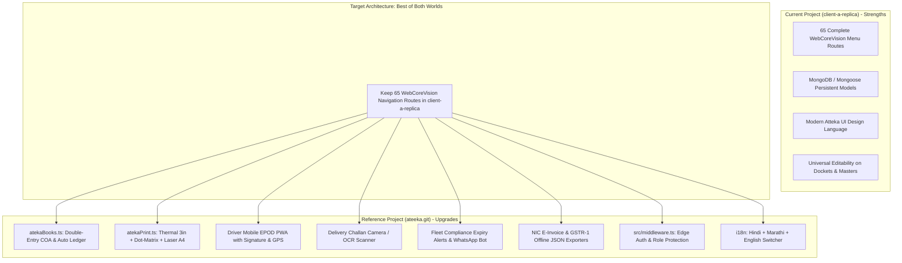

# COMPREHENSIVE PROJECT COMPARISON & UPGRADE ROADMAP
## Comparative Analysis: Current ERP (`client-a-replica`) vs Reference System (`Aitik-official/ateeka`)

**Reference Repository:** [`https://github.com/Aitik-official/ateeka.git`](https://github.com/Aitik-official/ateeka.git)  
**Live Reference Deployment:** [`https://ateeka.vercel.app/ateka`](https://ateeka.vercel.app/ateka)  
**Current Workspace:** `c:\Software\Atteka\client-a-replica`  
**Inspection Date:** November 5, 2026  
**Review Type:** Deep Architecture, Operational Workflow, Feature Gap, and Defect Assessment  

---

## 1. Executive Overview

This audit compares the two parallel implementations of the Atteka Logistics platform:
1. **Current Project (`client-a-replica`):**  
   Built as a high-fidelity visual and structural replication of the legacy WebCoreVision ASP.NET WebForms enterprise portal (`ateka.webcorevision.com`). It reproduces the full 8-module, 35-submodule, 65-route menu tree (Operations, Finance, CRM, Fleet, Tracking, Exceptional, Reports, Admin) on Next.js 15, Tailwind CSS, and Mongoose/MongoDB.
2. **Reference Project (`Aitik-official/ateeka` / `ateeka.vercel.app/ateka`):**  
   Built as a modern, stream-lined, flow-first logistics and warehouse engine. It features Prisma ORM with MongoDB, a unified operational desk pipeline (`/ateka`), a double-entry accounting engine (`atekaBooks.ts`), multi-format hardware printing (Thermal 3", Dot-Matrix, Laser A4), a Driver Mobile EPOD PWA with digital signature and GPS tagging, optical Delivery Challan scanning, automated WhatsApp fleet compliance alerts, and official NIC e-Invoice / GSTR-1 JSON schema compliance.

---

## 2. High-Level Comparison Matrix

| Capability / Architecture Area | Current Project (`client-a-replica`) | Reference Project (`ateeka.git` / `ateeka.vercel.app/ateka`) | Strategic Verdict |
| :--- | :--- | :--- | :--- |
| **Framework & Runtime** | Next.js `15.1.0` (App Router), React 19, TypeScript | Next.js `16.3.4` (App Router), React 19, TypeScript | Both modern App Router; Reference has latest Next.js 16 |
| **Database & ORM** | MongoDB via **Mongoose** (`src/models/*`) | MongoDB via **Prisma ORM** + `AtekaCollection` JSON models | Mongoose is flexible; Prisma provides strict schema compile safety |
| **Workflow / Operational "Flow"** | **Menu-Driven (Decoupled Hubs):** 65 separate route pages and action card grids. Workflows require jumping between submodules. | **Pipeline-Driven (Connected Desks):** Unified workflow desks (`/ateka/operations`, `/ateka/finance`) with tabs linking Booking ➔ Tripsheet ➔ Billing ➔ MR ➔ Ledger. | **Reference wins on Flow**; Current project has exact menu fidelity |
| **Accounting & Financial Ledger** | Simple CRUD models (`CustomerBill`, `MoneyReceipt`, `BankOperation`). No automated Chart of Accounts. | **Full Double-Entry Accounting Engine** (`atekaBooks.ts`): Automated Dr/Cr posting, Chart of Accounts, auto-balancing Trial Balance & P&L. | **Major Upgrade Opportunity from Reference** |
| **Printing & Stationery** | Standard browser window print on `/operations/dockets/[id]/print` | **Multi-Format Dedicated Print Engine** (`atekaPrint.ts`): 3-inch Thermal POS, Continuous Dot-Matrix, Laser A4 with Code128 barcodes. | **Major Upgrade Opportunity from Reference** |
| **Driver / Field Operations** | None. Field updates require desktop ERP operator interaction. | **Dedicated Mobile EPOD PWA** (`/ateka/driver`): Mobile viewport, touch signature pad, camera POD scan, GPS geotagging. | **Major Upgrade Opportunity from Reference** |
| **Delivery Challan Optical Scanner**| Manual docket entry form only. | **Automated Challan Scanner** (`/ateka/challan-scanner`): Camera OCR, auto-converts physical delivery challans into CNs. | **Major Upgrade Opportunity from Reference** |
| **Fleet Compliance & Expiry** | Master table in `/masters/vehicles` with manual review. | **Live Watchdog & WhatsApp Bot**: Automated expiry days countdown, one-click click-to-WhatsApp driver alert formatting. | **Major Upgrade Opportunity from Reference** |
| **Government GST & E-Invoice** | Simulated IRN hash and simulated QR in `/api/gst/irn`. | **Real NIC E-Invoice Encryption** (`nicEinvoice.ts`): RSA-2048 public key, AES-256-GCM, official Schema v1.03 + GSTR-1 offline JSON export. | **Major Upgrade Opportunity from Reference** |
| **Route Protection & Security** | Client-shell verification + API token check. No global `middleware.ts`. | **Global Edge Middleware** (`src/middleware.ts`): Cookie session verification, driver role redirection to `/ateka/driver`. | **Current Project Defect / Reference Upgrade** |
| **Multilingual Support (i18n)** | English only. | **English, Hindi (हिन्दी), Marathi (मराठी)** with instant switcher in header and driver PWA. | **High Value for Indian Logistics Operations** |
| **Legacy Visual Parity** | **98% Match** to WebCoreVision ASPX ERP menus, cards, and structure. | Modernized single-brand theme. Does not mirror WebCoreVision layout. | **Current Project wins on legacy ASPX parity** |

---

## 3. Why the Current Project "Didn't Have the Flow"

In your feedback, you noted that the current project *"didn't have the flow"*. Here is the technical explanation of why that occurred and how the reference repo addresses it:

### The Problem in `client-a-replica`:
1. **Isolated Card Hubs:**  
   Because the system was modeled directly on legacy ASP.NET WebForms (`RptFin.aspx?C009`, `RptFin.aspx?C181`, etc.), operations are fragmented into dozens of subcategory card hubs (`/operations/freight-booking`, `/operations/cn-operations`, `/finance/vouchers`, `/finance/customer-billing`).
2. **Missing Transaction Pipeline:**  
   When a user creates a new docket in `/operations/new-cn`, the docket is saved in MongoDB, but there is no direct step taking the user into assigning it to a Tripsheet, tracking its driver dispatch, completing its delivery run sheet (DRS), aggregating it into a bill, and generating a receipt. The user has to manually leave the page, open another sidebar group, find the right hub card, and re-search the docket.
3. **No Automatic Accounting Reaction:**  
   In `client-a-replica`, creating a bill or receiving money updates the bill status, but does not update a central General Ledger. Revenue, debtors receivable, and GST output tax remain isolated in separate collections.

### How `Aitik-official/ateeka` Solved the Flow:
1. **Unified Desk Architecture:**  
   Instead of 65 separate subpages, the reference repo consolidates the ERP into **interconnected operational desks**:
   - **Operations Desk (`/ateka/operations`):** One single workspace containing `[CN List] ➔ [New CN] ➔ [Prepare PDC Tripsheet] ➔ [Vehicle Allocation]`.
   - **Finance Desk (`/ateka/finance`):** Automatically detects all unbilled dockets, groups them by customer with one click, creates the bill, triggers NIC e-invoice generation, creates the Money Receipt, and auto-posts debit/credit ledger lines.
2. **Immediate Downstream Action Buttons:**  
   After booking a docket, the UI immediately presents buttons: *"Assign to Tripsheet"*, *"Print 3" Thermal Docket"*, or *"Send Driver WhatsApp"*.
3. **Double-Entry Synchronization:**  
   Every transaction automatically invokes `postLedger()`, ensuring the Trial Balance and P&L update instantaneously.

---

## 4. Top 10 High-Value Upgrades That Can Be Adopted from the GitHub Repo

The following 10 features from `Aitik-official/ateeka` represent major enterprise-grade upgrades that can be integrated into your project:

### 1. Double-Entry Chart of Accounts & General Ledger (`src/lib/atekaBooks.ts`)
- **What it is:** A complete double-entry accounting engine configured specifically for Indian freight logistics (Standard Chart of Accounts: `CASH`, `HDFC`, `DEBTORS`, `CREDITORS`, `GSTIN`, `GSTOUT`, `TDSREC`, `FREIGHTINC`, `FREIGHTEXP`).
- **How it works:**
  - When a CN is booked: Debits *Debtors Receivable*, Credits *Freight Income* & *GST Output*.
  - When an MR is received: Debits *Bank/Cash*, Credits *Debtors Receivable*, Credits *TDS Receivable*.
  - Auto-balances the Trial Balance (`totalDr === totalCr`), P&L, and Balance Sheet with zero manual bookkeeping.
- **File to adapt:** [`src/lib/atekaBooks.ts`](file:///c:/Software/Atteka/reference-ateeka/src/lib/atekaBooks.ts).

### 2. Multi-Format Hardware Print Engine (`src/lib/atekaPrint.ts`)
- **What it is:** Dedicated print formatter providing 3 distinct physical print layouts:
  1. **3-Inch Thermal POS Receipt:** Formatted for direct thermal counter printers at parcel booking offices.
  2. **Continuous Dot-Matrix Tractor Feed:** Formatted for 80-column dot-matrix printers on pre-printed carbon stationery.
  3. **Standard Laser A4 Consignment Note:** Crisp document layout with embedded Code128 barcodes, terms & conditions, and signature blocks.
- **File to adapt:** [`src/lib/atekaPrint.ts`](file:///c:/Software/Atteka/reference-ateeka/src/lib/atekaPrint.ts).

### 3. Driver Mobile EPOD PWA (`src/app/ateka/driver/page.tsx`)
- **What it is:** A mobile-optimized progressive web screen designed specifically for truck drivers and delivery executives on Android/iOS smartphones.
- **Key Capabilities:**
  - Real-time trip status toggle (`LOADING_AT_PLANT` ➔ `ON_THE_WAY` ➔ `REACHED_SITE` ➔ `DELIVERED_POD_UPLOADED`).
  - **HTML Canvas Touch Signature:** Receiver signs directly on the driver's phone screen.
  - **Camera Capture:** Direct camera photo upload of the physical stamped delivery challan.
  - **GPS Geotagging:** Automatically stamps delivery latitude, longitude, and timestamp on the POD record.
- **File to adapt:** [`src/app/ateka/driver/page.tsx`](file:///c:/Software/Atteka/reference-ateeka/src/app/ateka/driver/page.tsx).

### 4. Delivery Challan Camera & OCR Optical Scanner (`src/app/ateka/challan-scanner/page.tsx`)
- **What it is:** An automated document scanner that reads paper delivery challans from consignors or suppliers.
- **Key Capabilities:**
  - Extracts Challan Number, Net Weight, MT, Truck Registration, and Consignor.
  - With a single click on *"Generate CN from Challan"*, automatically creates a booked Consignment Note without manual re-typing.
  - Bulk invoice reconciliation for petrol pump diesel bills and tyre retreading invoices.
- **File to adapt:** [`src/app/ateka/challan-scanner/page.tsx`](file:///c:/Software/Atteka/reference-ateeka/src/app/ateka/challan-scanner/page.tsx).

### 5. Fleet Compliance Watchdog & WhatsApp Bot (`src/components/AtekaShell.tsx`)
- **What it is:** An automated fleet compliance monitoring engine.
- **Key Capabilities:**
  - Computes exact days remaining for Vehicle Fitness, Commercial Insurance, National Permit, and PUC across all fleet vehicles.
  - Visual color badges: Green (Valid), Yellow (`DUE_SOON` / < 30 days), Red (`EXPIRED`).
  - **Click-to-WhatsApp Generator:** Generates pre-filled WhatsApp alert messages formatted with vehicle number, expired documents, and renewal deadlines, opening `wa.me` for instant dispatch to drivers or vehicle owners.
- **Files to adapt:** [`src/lib/atekaStore.ts`](file:///c:/Software/Atteka/reference-ateeka/src/lib/atekaStore.ts) & [`src/components/AtekaShell.tsx`](file:///c:/Software/Atteka/reference-ateeka/src/components/AtekaShell.tsx).

### 6. Official Government NIC E-Invoice JSON Payload Generator (`src/lib/nicEinvoice.ts`)
- **What it is:** A production-grade e-invoice generator supporting both Sandbox and Live NIC IRP portals (`api.einvoice1.gst.gov.in`).
- **Key Capabilities:**
  - Implements RSA-2048 public key encryption and AES-256-GCM symmetric SEK decryption.
  - Serializes B2B transport invoices into official NIC Schema v1.03 JSON.
  - Validates HSN/SAC (9965 / 9967 for freight transport), state codes, and reverse charge flags.
- **File to adapt:** [`src/lib/nicEinvoice.ts`](file:///c:/Software/Atteka/reference-ateeka/src/lib/nicEinvoice.ts).

### 7. Official GSTR-1 Offline JSON Exporter (`src/lib/gstr1Json.ts`)
- **What it is:** Generates official `.json` export files conforming to GSTN offline utility specifications.
- **Key Capabilities:**
  - Groups billed invoices by recipient GSTIN (`ctin`).
  - Generates standard `b2b` (Business to Business), `b2cl` (Large Consumers), and `cdnr` (Credit/Debit Notes) sections.
  - Output file can be uploaded directly to `gst.gov.in` without manual portal data entry.
- **File to adapt:** [`src/lib/gstr1Json.ts`](file:///c:/Software/Atteka/reference-ateeka/src/lib/gstr1Json.ts).

### 8. Global Edge Route Middleware (`src/middleware.ts`)
- **What it is:** Server-side route interceptor protecting all ERP paths.
- **Key Capabilities:**
  - Intercepts requests before page rendering, checks the signed session cookie, and redirects unauthenticated requests to `/login?next=...`.
  - Enforces role-based pathing: if a user with role `driver` logs in, automatically confines their session to `/ateka/driver` and blocks access to financial or master desks.
  - Attaches `x-atteka-user` and `x-atteka-role` request headers for downstream API route security.
- **File to adapt:** [`src/middleware.ts`](file:///c:/Software/Atteka/reference-ateeka/src/middleware.ts).

### 9. Multi-Lingual Interface (Hindi, Marathi, English)
- **What it is:** A zero-flicker localized dictionary engine (`useAtekaLocale`).
- **Value in Logistics:** Most Indian truck drivers, transport yard staff, and warehouse loading supervisors are much more comfortable working in Hindi (हिन्दी) or Marathi (मराठी) than English. Having a language toggle right on the driver PWA and booking screens significantly reduces operational booking errors.
- **Files to adapt:** [`src/components/AtekaLocaleProvider.tsx`](file:///c:/Software/Atteka/reference-ateeka/src/components/AtekaLocaleProvider.tsx) and [`src/lib/i18n/`](file:///c:/Software/Atteka/reference-ateeka/src/lib/i18n).

### 10. Code128 Barcode Generation Engine (`src/lib/barcode.ts`)
- **What it is:** Automatic numeric and alphanumeric Code128 barcode generation using `jsbarcode`.
- **Key Capabilities:**
  - Stamps unique scannable barcodes on Consignment Notes, package stickers, and PDC loading manifests.
  - Barcode scanners can immediately scan dockets at transshipment hubs without manual typing.
- **File to adapt:** [`src/lib/barcode.ts`](file:///c:/Software/Atteka/reference-ateeka/src/lib/barcode.ts).

---

## 5. Detailed Defect & Gap Analysis of Current Project (`client-a-replica`)

Below is the list of concrete defects, architectural gaps, and workflow limitations currently present in `c:\Software\Atteka\client-a-replica`:

### 1. Disconnected Operational Flow (Defect: Architectural)
- **Issue:** The project separates Freight Booking, CN Operations, Tripsheets, Deliveries, and Billing into different isolated URLs (`/operations/freight-booking`, `/operations/cn-operations`, `/operations/tripsheets`, `/finance/customer-billing`).
- **Impact:** There is no guided step-by-step pipeline. After booking a docket, the user is left on the booking page rather than being offered an immediate action to assign the docket to an active tripsheet or generate a print slip.

### 2. Missing Server-Side Route Middleware (Defect: Security)
- **Issue:** `client-a-replica` does not have a root `src/middleware.ts`.
- **Impact:** Route protection relies on client-side React rendering inside `DashboardClientShell.tsx`. Direct browser requests to `/dashboard/*` render client HTML before checking auth tokens, leaving a security vulnerability.

### 3. Absence of Driver EPOD / Field Capture Mechanism (Defect: Functional)
- **Issue:** PODs in `client-a-replica` can only be uploaded by a desktop user uploading a file from disk (`api/upload`).
- **Impact:** Drivers in the field cannot capture live digital signatures, take real-time photos of stamped physical challans, or submit GPS-verified delivery timestamps.

### 4. Single-Format Browser Print Layout (Defect: UX / Hardware)
- **Issue:** Consignment printing in `client-a-replica` relies entirely on a generic browser print view in `/operations/dockets/[id]/print`.
- **Impact:** Does not support standard 3-inch thermal POS receipt rolls used at transport booking counters, nor tractor-feed dot-matrix continuous stationery used by accounts departments for multi-copy bills.

### 5. Isolated Billing without Automatic Double-Entry Ledger (Defect: Financial)
- **Issue:** In `client-a-replica`, invoices (`CustomerBill`) and Money Receipts (`MoneyReceipt`) are stored as isolated Mongoose records.
- **Impact:** There is no underlying Chart of Accounts. Generating a bill does not debit *Sundry Debtors* or credit *Freight Revenue / GST Output*. As a result, financial reports cannot produce a dynamic, auto-balancing Trial Balance or Balance Sheet.

### 6. In-Memory Fallback Redundancy (Defect: Code Quality)
- **Issue:** Several route handlers (e.g. `/api/consignments`, `/api/billing`) check MongoDB and fallback to `memoryStore.ts` if a query returns empty.
- **Impact:** Can cause split-brain data states where some changes persist in MongoDB while other secondary views display static in-memory seed records.

### 7. Static Vehicle Expiry Tracking (Defect: Fleet Management)
- **Issue:** Vehicle document dates (Fitness, Insurance, RC, Permit) are stored in the database, but there is no automated background calculation of expiring documents or notification trigger.
- **Impact:** Transport managers must manually open each vehicle record to check expiration dates rather than seeing real-time alerts or dispatching automated WhatsApp reminders.

### 8. Mock-Only GST IRN Generation (Defect: Compliance)
- **Issue:** `/api/gst/irn` returns an arbitrary 64-character hex string and mock QR code without formatting an official Government NIC payload.
- **Impact:** Cannot be toggled into a live or sandbox Government e-Invoice environment.

---

## 6. Recommended Action Plan & Synthesis

To achieve the ideal combination of **complete legacy WebCoreVision navigation parity** (which `client-a-replica` possesses) and **seamless end-to-end operational flow with advanced tools** (which `Aitik-official/ateeka` possesses), the following synthesis strategy is recommended:

### Proposed Phased Upgrades:
1. **Phase 1 (Security & Hardware Printing):**
   - Add `src/middleware.ts` from the reference repo to enforce global session security.
   - Integrate `atekaPrint.ts` to support 3" thermal receipts and continuous dot-matrix stationery on all dockets and bills.
2. **Phase 2 (Driver Mobile & Challan Scanner):**
   - Import the Driver Mobile EPOD PWA (`/driver`) and Challan Scanner (`/challan-scanner`) into `client-a-replica`.
3. **Phase 3 (Accounting & Compliance):**
   - Integrate `atekaBooks.ts` so that creating CNs, Bills, and MRs automatically balances the General Ledger.
   - Add the WhatsApp fleet compliance notification drawer and GSTR-1 offline JSON exporter.
4. **Phase 4 (Localization):**
   - Add the Hindi & Marathi language selector for yard and driver operations.

---

## 7. Conclusion

- **`client-a-replica`** excels in replicating the complete, exact menu hierarchy and enterprise structure of the legacy WebCoreVision ERP (65 functional sub-pages, full MongoDB models, and universal editing capabilities).
- **`Aitik-official/ateeka`** excels in operational execution: it provides the missing end-to-end transaction flow, double-entry bookkeeping, multi-format hardware printing, driver EPOD mobile capture, optical challan scanning, and automated WhatsApp compliance dispatch.
- By integrating the 10 core modules identified above into `client-a-replica`, you can transform the current project into an industry-leading, fully automated transport ERP without losing any of your existing screens or customization.

