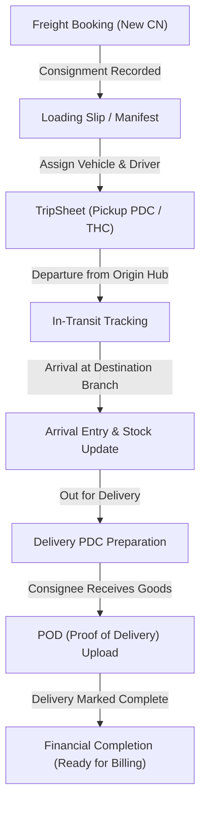
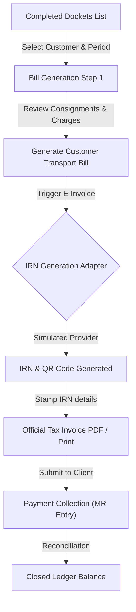
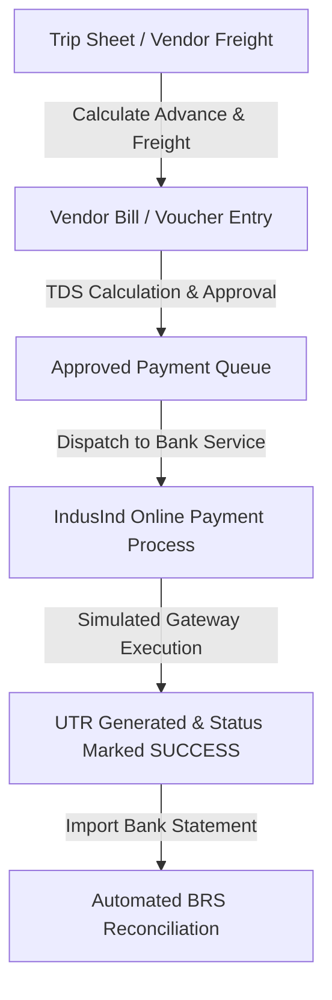

# OPERATIONAL WORKFLOW DIAGRAMS

## 1. Freight Booking to Delivery Workflow (Operations)

## 2. Customer Billing and GST E-Invoice (IRN) Lifecycle

## 3. Vendor Payment & Bank Integration Workflow (Simulated)

